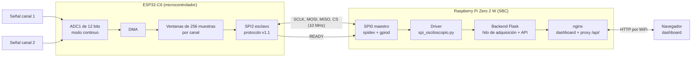
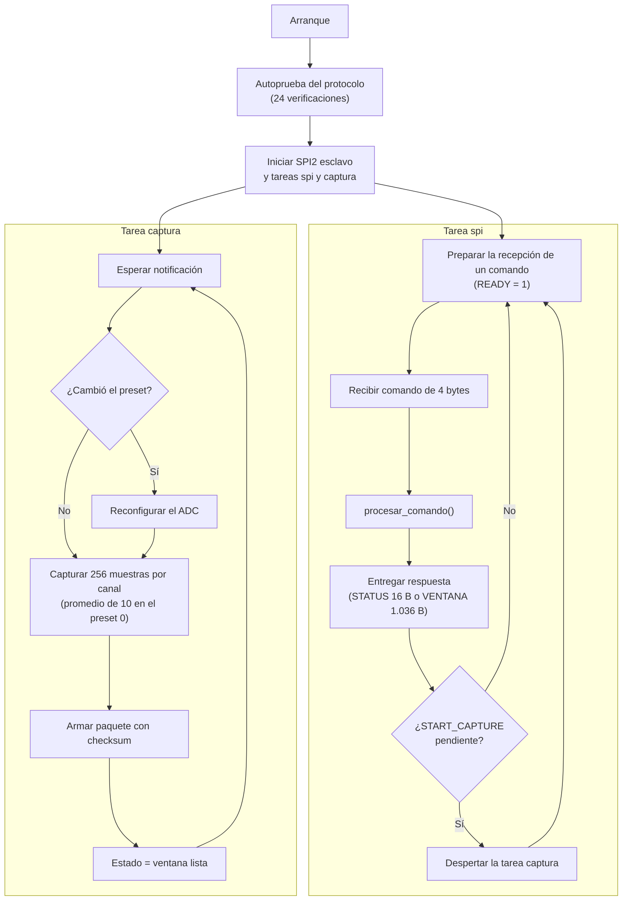
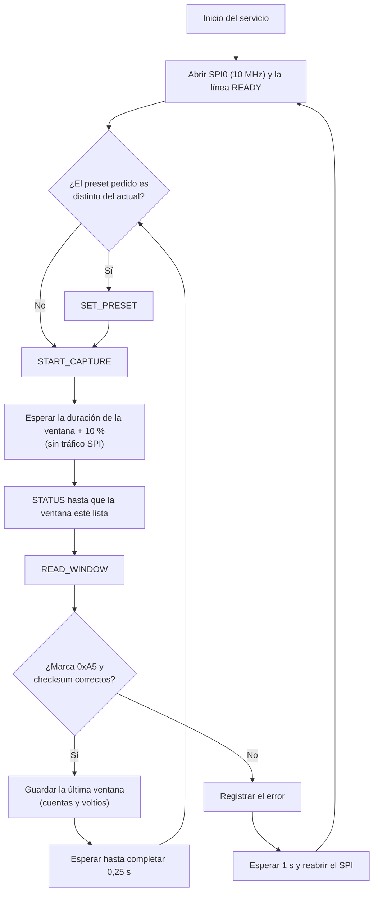
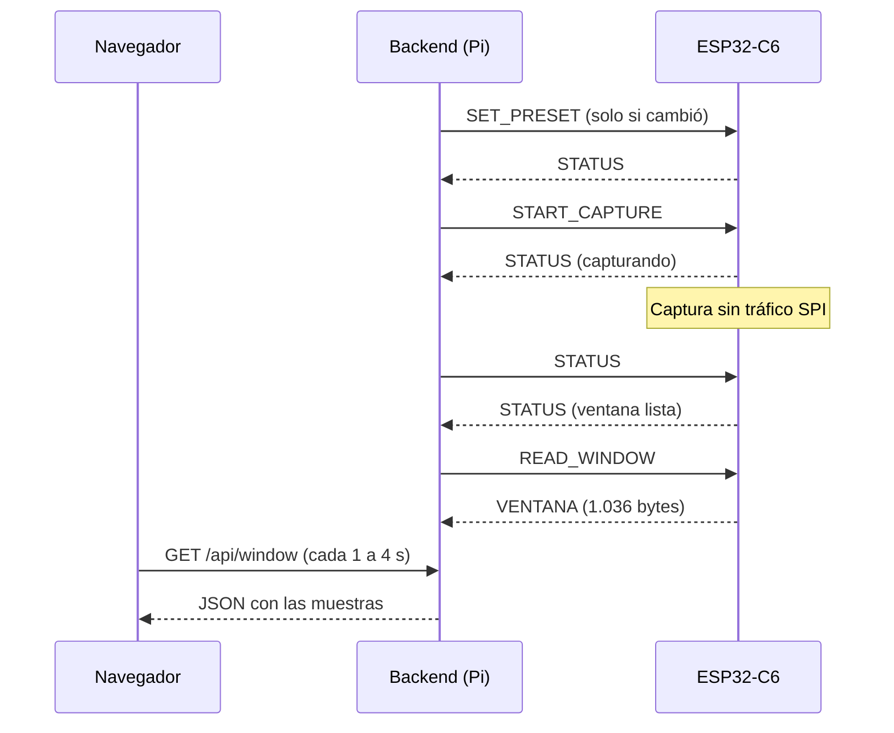

# Arquitectura, requerimientos y restricciones

## 1. Diagrama de bloques

| Bloque | Implementación | Función |
|---|---|---|
| Adquisición | ADC1 del ESP32-C6 en modo continuo con DMA (GPIO0 y GPIO1) | Muestrear los dos canales a frecuencia constante |
| Ventanas y presets | Firmware en C (ESP-IDF v5.5), tarea `captura` | 256 muestras por canal; presets de 100, 1.000, 10.000 y 40.000 Sa/s |
| Comunicación | SPI2 esclavo (ESP32-C6) y SPI0 maestro (Pi), más la línea READY | Protocolo de comandos v1.1 (`docs/protocolo-spi.md`) |
| Driver | `sbc/backend/spi_osciloscopio.py` | Comandos, sincronización con READY, verificación de marca y checksum |
| Backend | `sbc/backend/app.py` (Flask), servicio systemd | Hilo único que usa el SPI; API HTTP (`docs/api-http.md`) |
| Servidor web | nginx | Sirve el dashboard y reenvía `/api/` al backend |
| Dashboard | `sbc/web/index.html` | Gráfica de los dos canales, selector de preset y refresco de 1 a 4 s |

## 2. Diagrama de flujo del firmware (ESP32-C6)

## 3. Diagrama de flujo del backend (Raspberry Pi)

Los endpoints HTTP (`/api/status`, `/api/window` y `/api/preset`) no usan el SPI: solo leen la última ventana guardada o cambian el preset pedido, que el hilo aplica antes de la siguiente captura.

## 4. Diagrama de secuencia de una captura

Cada flecha entre el backend y el ESP32-C6 es una transacción SPI: el comando (4 bytes) y la respuesta van en transacciones separadas, y antes de cada una la Pi espera que READY esté en alto.

## 5. Requerimientos

### Funcionales (del enunciado)

| ID | Requerimiento | Cómo se cumple |
|---|---|---|
| R1 | La SBC sirve un dashboard web con un servidor HTTP (apache o nginx) | nginx en la Pi sirve el dashboard y reenvía la API |
| R2 | Comunicación SBC ↔ microcontrolador por SPI | SPI0 (Pi, maestro) y SPI2 (ESP32-C6, esclavo), protocolo v1.1 |
| R3 | Ventanas de al menos 64 muestras a frecuencia constante | 256 muestras por canal, ADC en modo continuo con DMA |
| R4 | Al menos 3 presets cambiables por SPI: 100, 1.000 y 10.000 Sa/s | 4 presets (incluido 40.000 Sa/s), comando SET_PRESET |
| R5 | Refresco del dashboard entre 0,25 y 1 Hz | Selector de 1, 2, 3 y 4 s |
| R6 | Tasas SPI teóricas (hojas de datos) y experimentales | Teórica 40 MHz; experimental 25 MHz sin errores |
| R7 | Bonus: ≥ 40.000 Sa/s verificados | 40.322,58 Sa/s por canal, verificados con señal externa |

La verificación de cada uno está en `docs/matriz-verificacion.md`.

### No funcionales (definidos por el equipo)

| ID | Requerimiento |
|---|---|
| N1 | El sistema arranca solo al encender la Pi, sin intervención por SSH |
| N2 | Se detectan los errores de comunicación (marca 0xA5 y checksum) y el sistema se recupera solo |
| N3 | Varios navegadores pueden consultar a la vez sin interferir con el SPI (un solo hilo usa el bus) |
| N4 | El software de la Pi se puede desarrollar y probar sin hardware (simulador y pruebas automáticas) |
| N5 | El dashboard funciona sin conexión a internet (sin librerías externas) |

## 6. Restricciones

| Restricción | Origen | Consecuencia en el diseño |
|---|---|---|
| Lógica de 3,3 V en ambas placas | Hojas de datos | Conexión directa, sin conversores; nunca 5 V en los GPIO |
| Rango del ADC de 0 a 3,3 V (atenuación de 12 dB), 12 bits, error de hasta ±40 mV | Hoja de datos del ESP32-C6 | Las señales de entrada deben estar entre 0 y 3,3 V; la conversión a voltios usa la calibración medida |
| Modo continuo del ADC: entre 611 y 83.333 Hz en total | `soc_caps.h` de ESP-IDF | 100 Sa/s por canal (200 Hz en total) no cabe: se muestrea a 1.000 Sa/s y se promedia de a 10. El máximo es ~41.600 Sa/s por canal |
| El reloj del ADC solo admite divisores enteros | Medido y verificado | El preset de 40.000 Sa/s es en realidad de 40.322,58; el ESP32-C6 informa la frecuencia real |
| El esclavo SPI no puede responder en la misma transacción del comando | Funcionamiento del SPI | Dos transacciones por comando y una línea READY para sincronizar |
| SPI con cables jumper: 25 MHz sin errores (teórico: 40 MHz) | Medido | Se trabaja a 10 MHz, con margen |
| El tráfico SPI durante la captura induce ruido en el ADC | Medido (V3) | La captura empieza después de responder START y el backend no consulta durante la captura |
| GPIO16 y GPIO17 son el UART0 del puente USB; GPIO8, GPIO9 y GPIO15 son de arranque | Placa y hoja de datos del ESP32-C6 | CS en GPIO18 y READY en GPIO19 |
| WiFi de la Pi Zero 2 W solo en 2,4 GHz | Hoja de datos de la Pi | El punto de acceso debe transmitir en 2,4 GHz |
| 512 MB de RAM en la Pi | Hoja de datos de la Pi | Backend liviano (Flask) con paquetes del sistema |
| Solo un proceso puede usar el SPI y la línea READY | Linux (`spidev`, `gpiod`) | El backend es el único dueño del bus; las herramientas de prueba requieren detenerlo |
